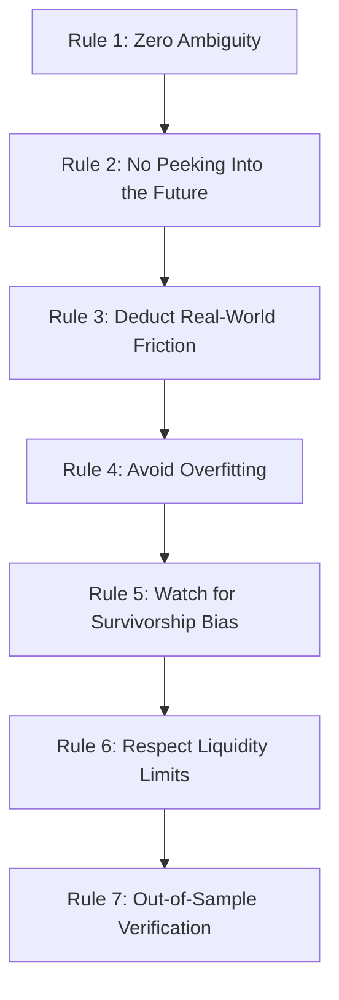
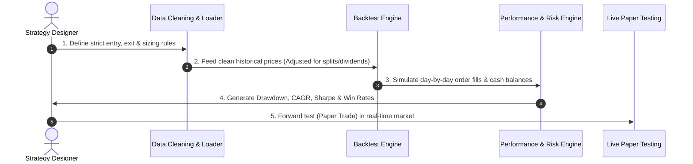

# The Fundamental Rulebook to Backtesting
### *How Trading & Investment Strategies Are Tested Before Risking Real Capital*

---

## 1. What is Backtesting? (The Flight Simulator Analogy)

Imagine you are an aeronautical engineer designing a brand-new passenger jet. Would you build it, put passengers inside, and launch it into a Category 5 hurricane on day one? 

**Never.** 

First, you run thousands of hours in a high-fidelity **flight simulator**. You simulate extreme crosswinds, engine failures, ice storms, and sudden clear-air turbulence using decades of historical meteorological data.

> [!NOTE]
> **Backtesting is a flight simulator for money.**
> It takes a set of mechanical, rule-based trading instructions (e.g., *"Buy when price crosses above a 20-week high, sell if it drops 8%"*) and feeds past market price history into a computer. The simulator calculates: *"If an automated robot had traded these exact rules over the last 10, 15, or 20 years, would you have made money, survived the crashes, or gone bankrupt?"*

---

## 2. The 7 Golden Rules of Backtesting

To trust backtest results, the simulation must adhere strictly to the **7 Golden Rules**. If any rule is broken, the results are fiction.

### Rule 1: Zero Ambiguity (The Robot Test)
Every single condition for buying, selling, and managing risk must be strictly mathematical. 
- ❌ **Ambiguous:** *"Buy when the company feels undervalued or the chart looks bullish."*
- ✔️ **Objective:** *"Buy when the daily close is greater than the highest high of the last 20 trading sessions."*
> **The Robot Test:** If you handed your rules to 5 different software programmers, all 5 must produce identical trades down to the exact cent.

### Rule 2: Never Peek Into Tomorrow (Lookahead Bias)
A simulation can accidentally cheat if it looks at information that was not yet known at that moment in time.
- *Example cheat:* Deciding to enter a trade at 9:30 AM based on the closing price at 3:30 PM of that same day.
- *The Rule:* You can only make decisions based on data that was finalized and known *before* the trade took place.

### Rule 3: The Tax Man & The Toll Booth (Friction & Costs)
In the real world, trading is never free. A strategy that makes $10,000 on paper might lose $2,000 in reality once you pay:
1. **Brokerage Fees & Exchange Levies:** Transaction charges.
2. **Slippage:** The difference between the price you wanted and the actual price you received when matching orders in a moving market.
3. **Taxes:** Capital gains and transaction taxes.
> **The Rule:** Always deduct realistic commissions and slippage on every simulated buy and sell.

### Rule 4: Don't "Curve-Fit" the Past (Overfitting)
Imagine tailoring a suit so tightly to one mannequin that nobody else in the world can wear it. That is **curve-fitting**.
- If you test 1,000 combinations of numbers until you find that *"Buying on Tuesday at 11:03 AM with a 7.34% stop loss"* produced massive returns in 2021, you didn't discover a principle—you just memorized history.
> **The Rule:** Simple, robust rules that work across different markets and asset classes always beat hyper-optimized recipes.

### Rule 5: Don't Test Only on the Living (Survivorship Bias)
If you evaluate the stock market over the last 20 years using only the companies in the index *today*, you have ignored all the companies that went bankrupt, merged, or got delisted along the way (e.g., Enron, Lehman Brothers, Kodak).
- If your backtest only runs on today's winners, your results will be artificially inflated.
> **The Rule:** Use point-in-time historical constituent data that includes companies that failed.

### Rule 6: Respect Liquidity (The Market Impact Rule)
On paper, a small stock traded at $5.00, and your system says to buy $1,000,000 worth. In real life, there may only have been $10,000 worth of shares available for sale at that price. Attempting to buy $1,000,000 would spike the price to $7.00.
> **The Rule:** Never assume your order could exceed a small percentage (e.g., 2%–5%) of the average daily traded volume.

### Rule 7: Always Reserve an "Out-of-Sample" Exam
Never judge a student on exam questions they were allowed to practice on beforehand.
- Divide your historical data into two parts:
  1. **In-Sample Data (Training):** e.g., 2010 to 2020. You test and refine the idea here.
  2. **Out-of-Sample Data (Testing):** e.g., 2021 to 2025. You lock the rules and run the test **once** on this unseen data.
> **The Rule:** If the strategy fails on unseen out-of-sample data, it is rejected immediately.

---

## 3. The 5-Step Backtesting Lifecycle

### Step 1: Strategy Specification
Define the complete blueprint:
- **Universe:** Which stocks/assets are eligible? (e.g., Top 500 liquid stocks).
- **Entry Trigger:** Exactly what causes a purchase?
- **Position Sizing:** How much money goes into each trade? (e.g., 10% per trade, maximum 10 open positions).
- **Exit Trigger (Stop Loss):** When do we cut losses? (e.g., -8% from entry).
- **Exit Trigger (Take Profit / Trailing Stop):** When do we book gains?

### Step 2: Data Cleaning & Hygiene
Market data is notoriously messy. Before running tests, data must be adjusted for:
- Stock splits (e.g., 2-for-1 splits that cut price in half overnight).
- Dividends and bonus issuances.
- Missing days, holidays, and sudden data outages.

### Step 3: Bar-by-Bar Simulation
The backtest engine iterates through time chronologically, day by day (or minute by minute):
1. Reads previous day's closing prices.
2. Identifies if any triggers fired.
3. Places orders at realistic next-session prices (e.g., Next Open).
4. Updates account equity, cash balance, and open trade risk.

### Step 4: Metric Evaluation (The Health Check)
Instead of just asking *"Did it make money?"*, we analyze *how* it made money, how much pain it inflicted, and whether the performance was steady or just one lucky trade.

### Step 5: Forward Testing / Paper Trading
Before committing a single dollar:
- Run the strategy on live streaming data with simulated "fake" money for 1 to 3 months.
- Compare live execution against simulated expectations.

---

## 4. The Performance Scorecard

Here is how to read a backtest report without getting lost in complex math:

| Metric | Plain English Translation | Good Benchmark | Red Flag |
| :--- | :--- | :--- | :--- |
| **CAGR** *(Compound Annual Growth Rate)* | Average annual return compounded year over year. | 15% – 25% | > 80% (often indicates curve-fitting or penny-stock errors) |
| **Max Drawdown (MDD)** | The worst peak-to-trough drop. *"How much money did you lose from the absolute peak before recovering?"* | -15% to -25% | Deeper than -35% (Psychologically devastating for most people) |
| **Win Rate** | Percentage of trades that ended green. | 40% – 55% | 90%+ (Usually hides an unchecked catastrophic tail risk) |
| **Profit Factor** | Ratio of Gross Profits to Gross Losses. *(Total money won divided by total money lost)* | 1.6 – 2.5 | < 1.2 (Barely breaking even after friction) |
| **Sharpe Ratio** | Return achieved per unit of volatility. *"Was the ride smooth or a roller coaster?"* | > 1.0 (Good) > 1.5 (Great) | < 0.5 (Uncompensated risk) |
| **Calmar Ratio** | CAGR divided by Max Drawdown. *"Is the annual reward worth the worst drop?"* | > 0.8 | < 0.3 |
| **Max Recovery Time** | The longest time your account spent underwater before reaching a new high. | < 12 months | > 2.5 years (Most investors give up during this time) |

> [!TIP]
> **The Win Rate Myth:** 
> Laymen often believe a great trading system must win 80% or 90% of the time. 
> In reality, many of the greatest trend-following strategies in history win only **40% to 45% of trades**. They succeed because their average win is 3x to 5x larger than their average loss:
> - *Win 4 trades: +$3,000 each = +$12,000*
> - *Lose 6 trades: -$1,000 each = -$6,000*
> - *Net Profit: +$6,000 (even though you were wrong more than half the time!)*

---

## 5. The Top 5 Illusions to Watch Out For

When someone shows you a backtest chart that goes up in a smooth 45-degree angle, check for these common traps:

1. **The Martingale Trap (Double-Down-on-Loss):**
   - The strategy doubles its position size every time it loses. It shows a 95% win rate until one bad streak wipes out 100% of the account.
2. **The "Hindsight Genius" Trap:**
   - Choosing indicators specifically because they caught the bottom of the March 2020 crash, knowing full well what happened next.
3. **The Micro-Cap Mirage:**
   - The strategy made huge profits buying tiny, illiquid stocks that trade $500 a day. You could never replicate it with institutional or retail size.
4. **Zero-Commission Fantasy:**
   - Generating 50 trades a day and assuming zero commission and zero bid-ask spread.
5. **Short-Sample Mirage:**
   - Testing only between April 2020 and November 2021—a period where virtually every stock on earth went up. A valid backtest must survive major historical bear markets (e.g., 2008 GFC, 2018 chop, 2020 crash, 2022 rate-hike bear).

---

## 6. The Readiness Checklist: Can We Trade This Live?

Use this checklist before authorizing real money:

- [ ] **Clean Rules:** Are all rules 100% programmable without any discretionary discretion?
- [ ] **Sufficient History:** Does the backtest cover at least 7–10 years and at least 2 full market cycles (bull, bear, and sideways)?
- [ ] **Sample Size:** Are there at least 200–300 completed historical trades? (Statistically meaningful).
- [ ] **Friction Deducted:** Were commissions, taxes, and slippage included?
- [ ] **Drawdown Tolerance:** Can the investor mentally endure the strategy's worst historical drawdown?
- [ ] **Out-of-Sample Success:** Did the strategy perform acceptably on unseen out-of-sample data?
- [ ] **Paper-Traded:** Has the strategy run live on paper for at least 30–60 days without execution surprises?
