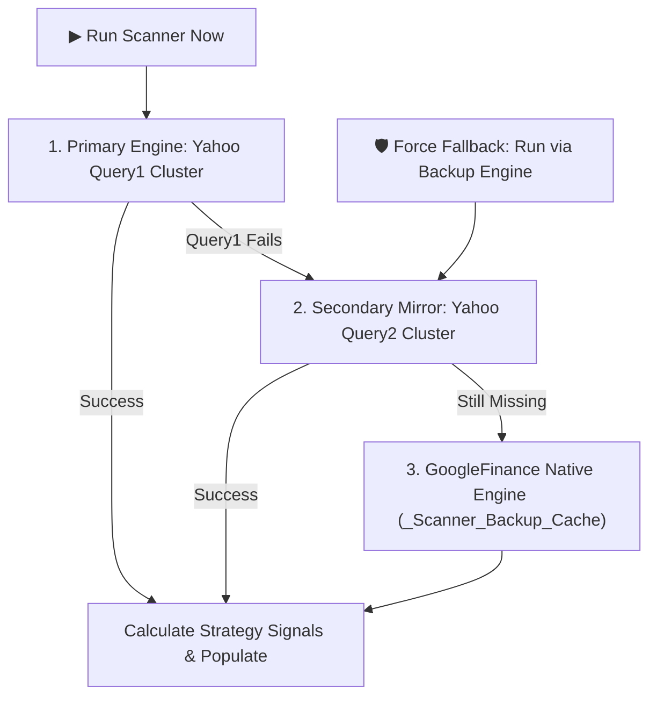
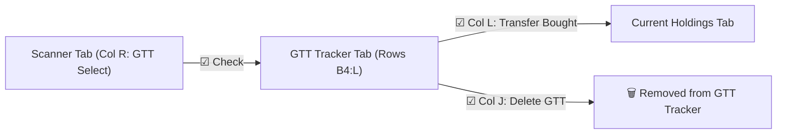
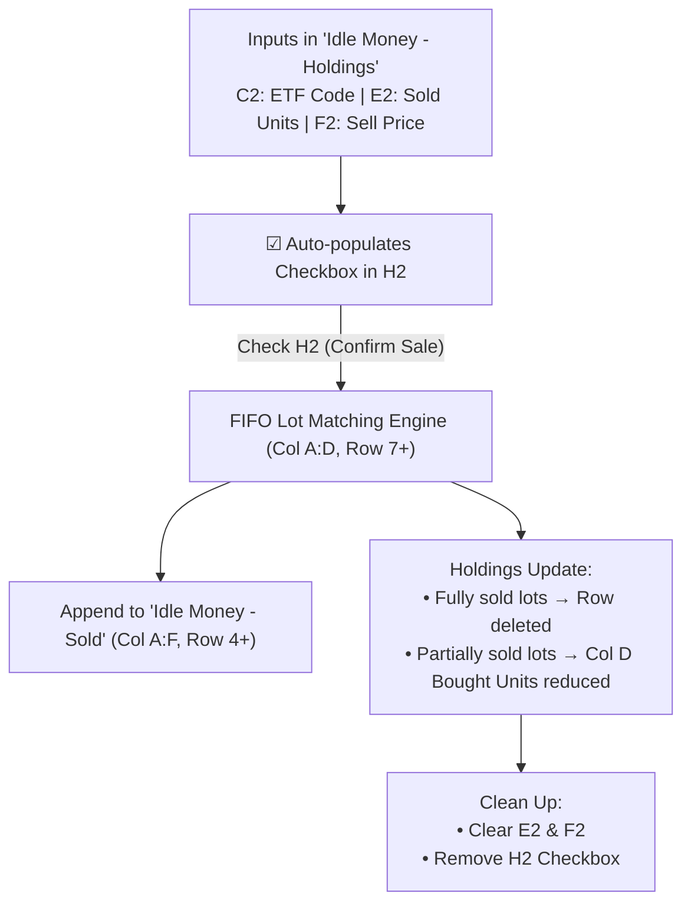

# Google Sheets Scanner Setup & Operational Guide
### *Darvas Bearish + Bullish Combo Systematic Strategy Scanner*

---

## 1. Overview of the Scanner Layout

The script is built specifically for the tab named **`Scanner`** based on your exact layout:

| Column | Header (Row 5) | Description & Population Method |
| :---: | :--- | :--- |
| **A** | `50 NSE Codes` | **Input Column (Row 7 downwards):** User enters stock tickers in `NSE:INFY`, `NSE:YESBANK`, `NSE:BHARTIARTL` format. |
| **B - D** | `Custom 1 - 3` | **User Custom Columns:** Untouched by the script; can be used for custom notes or user tags. |
| **E** | `Last Buy Price of Already Bought Stock` | **Dynamic Formula in E6:** `=IFERROR(ARRAYFORMULA(XLOOKUP(J6:J,'Current Holdings'!B:B,'Current Holdings'!C:C,,,-1)))` |
| **F** | `Distance between Suggested Buy Price and Last Buy Price` | **Dynamic Formula in F6:** `=IFERROR(ARRAYFORMULA(IF(O6:O="",,O6:O/E6:E-1)))` |
| **G** | `Already Bought Tranches` | **User / Portfolio Column:** Dynamic formula in G6: `=IFERROR(ARRAYFORMULA(XLOOKUP(J6:J,'Current Holdings'!S:S,'Current Holdings'!X:X)))` |
| **H** | `Bullish Buy Already Done?` | **Dynamic Formula in H6:** `=IFERROR(ARRAYFORMULA(IF(VLOOKUP(J6:J,FILTER('Current Holdings'!B8:B,'Current Holdings'!E8:E="Bullish Buy"),1,0)<>"","Yes","No")))` |
| **I** | `GTT Select` | Auto-populated checkbox (`☑`) for buy-eligible stocks (`Bullish Buy Triggered` or `Bearish Buy Triggered`). Checking queues order to `GTT Tracker`. |
| **J** | `Stock Code` | **Output Column (Row 7 downwards):** Tickers sorted strictly in the 4-tier strategy order. |
| **K** | `Status` | **Sorted in this exact order:**<br>1. `Bullish Buy Triggered`<br>2. `Bearish Buy Triggered`<br>3. `Tracking for Bearish Buy Signal`<br>4. `Bullish Buy Running`<br>5. `Neutral / Inside 20W Range`<br>*(Rows formatted with status color across Col J to P for Buy Triggered stocks only)* |
| **L** | `Previous Week High` | **High of Last to Last Week ($W_{t-1}$)** |
| **M** | `Last Week's Close` | **Close of Last Completed Week ($W_t$)** |
| **N** | `Breakout % (Rise)` | **Percentage rise:** `(Col M - Col L) / Col L` = `(Last Week Close - Last to Last Week High) / Last to Last Week High`. Formatted as `0.00%`. Sorted least risen first for triggered stocks. |
| **O** | `Buy Limit Ceiling (+0.5%)` | **Dynamic Formula in O6:** `=IFERROR(ARRAYFORMULA(IF(K6:K="",,IF(ISNUMBER(SEARCH("Buy Triggered", K6:K)), CEILING(M6:M*1.005, 0.05), ""))))` *(Calculated from Col M Close)* |
| **P** | `CMP` | **Dynamic Formula in P6:** `=IFERROR(MAP(J6:J,LAMBDA(ticker, IF(ticker="",, GOOGLEFINANCE(ticker,"price")))))` |
| **Q** | `20W Low Breakdown Signal` | Displays `'20W Low Breakdown'` if 20-week low was touched in recently completed week, else Blank. |

---

### Executive Summary KPI Cards (Rows 1–2, Columns J through P)

The top rows **Rows 1–2 from Column J to P** are dynamically formatted into three modern KPI summary cards (Row 3 is kept completely clear as a clean visual spacer):

```
┌───────────────────────────────────────┬───────────────────────────────┬───────────────────────────────┐
│        Columns J : L (Card 1)         │     Columns M : N (Card 2)    │     Columns O : P (Card 3)    │
├───────────────────────────────────────┼───────────────────────────────┼───────────────────────────────┤
│         Bullish Buy Triggered         │     Bearish Buy Triggered     │       Last Scan ran on        │
│                  1                    │               6               │       24-Oct-2026 09:51       │
└───────────────────────────────────────┴───────────────────────────────┴───────────────────────────────┘
```

1. **Card 1: Bullish Buy Triggered (Columns J to L, Rows 1–2)**
   - **Row 1:** Header title `"Bullish Buy Triggered"` (Soft Emerald background `#D1FAE5`, dark green text `#065F46`, bold 11pt).
   - **Row 2:** Metric count of triggered bullish stocks (Large bold 20pt font `#047857`, soft background `#ECFDF5`).
   - **Border:** Soft emerald medium border `#A7F3D0` around `J1:L2`.

2. **Card 2: Bearish Buy Triggered (Columns M to N, Rows 1–2)**
   - **Row 1:** Header title `"Bearish Buy Triggered"` (Soft Blue background `#DBEAFE`, dark blue text `#1E40AF`, bold 11pt).
   - **Row 2:** Metric count of triggered bearish dip-harvester stocks (Large bold 20pt font `#1D4ED8`, soft background `#EFF6FF`).
   - **Border:** Soft blue medium border `#BFDBFE` around `M1:N2`.

3. **Card 3: Last Scan ran on (Columns O to P, Rows 1–2)**
   - **Row 1:** Header title `"Last Scan ran on"` (Soft Slate background `#E2E8F0`, dark slate text `#1E293B`, bold 11pt).
   - **Row 2:** Execution timestamp strictly formatted in **`dd-mmm-yyyy HH:MM`** (e.g. `24-Oct-2026 09:51`, bold 13pt font `#0F172A`, light slate `#F8FAFC`).
   - **Border:** Soft slate medium border `#CBD5E1` around `O1:P2`.

---

## 2. Core Execution Mechanics: How Signals are Tracked

```
┌───────────────────────────────────────┬───────────────────────────────────────┐
│     Column L (High of Last to Last)   │        Column M (Close of Last Week)  │
│               1,854.70                │                   1,905.00            │
└───────────────────────────────────────┴───────────────────────────────────────┘
                                       ▲
   Trigger Check: Is Close of Last Week (Col M) > High of Last to Last Week (Col L) ?
   1,905.00 > 1,854.70  ==>  YES (Breakout Triggered!)
   Col N (Breakout % Rise): (1,905.00 - 1,854.70) / 1,854.70 = +2.71%
   Col O (Buy Limit Ceiling): CEILING(1,905.00 * 1.005, 0.05) = 1,914.55
```

### 1. Robust Indian Standard Time (IST) & Exchange Holiday Week Detection:
* The script uses a dynamic calendar week resolver with explicit **NSE Exchange Holiday awareness**:
  - **Holiday-Shortened Weeks (e.g. Week Ending Thursday 1 Oct 2026 before Gandhi Jayanti):**
    - Both Yahoo Finance and GoogleFinance automatically package shortened weeks into a single weekly bar with the **Thursday close**.
    - If executed on **Thursday after 3:30 PM IST** before a Friday holiday, or **anytime on the Friday holiday**, the script automatically recognizes that the exchange closed on Thursday and treats that Thursday as the completed weekly close!
  - **Normal Weeks:**
    - If executed on **Friday after 3:30 PM IST**, or on **Saturday / Sunday**:
      - **Last Week ($W_t$):** The week that just completed (Close goes to **Col M**).
      - **Last to Last Week ($W_{t-1}$):** The prior completed week (High goes to **Col L**).
  - **Mid-Week Safeguard (Monday to Friday before 3:30 PM IST):**
    - The ongoing, incomplete week is automatically ignored to protect against executing on partial fluctuating bars.
    - Evaluates the previously finalized completed week.

### 2. Bearish Tracking Trigger: 20-Week Low Touched
* Tracking starts as soon as the **Weekly Low touches or breaches the rolling 20-Week Low** (`Weekly Low <= 20W Low`).
* **Bharti Airtel Case Study:**
  - **Week ending 1 Oct 2026:** Bharti Airtel touched its 20-week low $\rightarrow$ `isTracking20w` turned **ON** (`Tracking for Bearish Buy Signal`).
  - **Week ending 9 Oct 2026:**
    - High of Last to Last Week (Col L) = `1,854.70`
    - Close of Last Week (Col M) = `1,905.00`
    - Since `1,905.00 > 1,854.70`, **`Bearish Buy Triggered`** fired cleanly!

### 3. Strict Priority Sorting in Column K:
The stocks in Columns J through Q are sorted strictly in your exact specified priority:
1. **`Bullish Buy Triggered`:** Fresh 20-week high breakouts this week, sorted by Column N `Breakout % (Rise)` ascending (least risen first at the top for best risk/reward entry).
2. **`Bearish Buy Triggered`:** 20W floor touched & weekly swing breakout this week (`Close > Prev Week High`), sorted by Column N `Breakout % (Rise)` ascending.
3. **`Tracking for Bearish Buy Signal`:** Stocks that touched their 20W floor and are awaiting a weekly swing breakout (e.g. `NSE:YESBANK`).
4. **`Bullish Buy Running`:** Stocks previously bought on a Bullish signal that have **not touched the 20-week low yet** (e.g. `NSE:ABCAPITAL`). These are active compounders riding the bull run above the 20W floor.
5. **`Neutral / Inside 20W Range`:** Stocks fluctuating inside range without touching 20W low or high breakout.

*(Note: If a previously running bullish stock touches its 20-week low, it immediately ceases to be 'Bullish Buy Running' and transitions into 'Tracking for Bearish Buy Signal'. If that breakdown happened during the completed week, Col Q flags '20W Low Breakdown'.)*

---

## 3. Step-by-Step Installation in Google Sheets

### Step 1: Open Apps Script
1. Open your Google Sheet containing the **`Scanner`** tab.
2. In the top menu, click **Extensions** $\rightarrow$ **Apps Script**.

### Step 2: Paste the Updated Script
1. Select all and replace the contents of `Code.gs` with the updated code from [google_apps_script_scanner.js](file:///c:/Users/krish/API/Anti%20Gravity/Strategies/Darvas%20Bearish%20+%20Bullish%20combo/google_apps_script_scanner.js).
2. Click the **💾 Save** icon (or press `Ctrl + S`).

### Step 3: Run the Scanner
1. Return to your Google Sheet and refresh the page (`F5`).
2. Click **`⚡ Darvas Scanner`** in the top menu $\rightarrow$ **`▶ Run Scanner Now`**.
3. The scanner will fetch data in parallel from Yahoo Finance, calculate all signals, populate rows, and apply conditional colors automatically.

---

## 4. Dual-Engine Resilience & High Availability

To ensure the scanner never fails even if Yahoo Finance experiences downtime or network throttling, the system includes a **two-tier automatic failover architecture**:



### 1. Automatic Failover & High-Capacity Batching (200+ Stocks):
* **Primary (Yahoo Finance Batching):** Automatically slices large stock universes (such as the 213 F&O stocks or Nifty 500) into safe concurrent batches of 25 requests via `UrlFetchApp.fetchAll`. This completes 200+ stocks in ~3–4 seconds without hitting Google Apps Script socket limits or triggering rate-limits.
* **Secondary Mirror (`query2` & Individual Retry):** If any batch encounters network throttling or server blips on `query1`, the script immediately retries via `query2.finance.yahoo.com`, followed by targeted single-stock retries.
* **Tertiary Native Fallback (`GOOGLEFINANCE` Safe Chunking):** If any ticker is absent on both primary and mirror servers, the script activates a temporary calculation tab, batches requests into 15-stock chunks with display-value polling, and extracts available candles.

### 2. Manual Backup Engine Override:
You can also run the scanner via the dedicated backup mirror cluster at any time:
* Click **`⚡ Darvas Scanner`** $\rightarrow$ **`🛡 Force Fallback: Run via Backup Engine`**.

---

## 5. GTT Order Tracking & 'Current Holdings' Transfer Workflow

The system provides an automated pipeline linking the **`Scanner`**, **`GTT Tracker`**, and **`Current Holdings`** sheets:



### 1. From Scanner to GTT Tracker:
- When a buy-eligible stock (`Bullish Buy Triggered` or `Bearish Buy Triggered`) is selected via the checkbox in **Column I (GTT Select)** on the `Scanner` tab:
  - It moves automatically into **`GTT Tracker`** at the next available row (finding the first empty row in Column B from row 4 onwards).
  - **Col B:** Stock Code, **Col C:** GTT Order Price, **Col D:** Signal Type.
  - **No formatting applied:** Data in Columns B–D is strictly pasted as **pure values**, preserving any existing sheet formats and applying zero custom backgrounds, font weights, or colors.
  - Rows are cleared from `Scanner` results so you don't place duplicate orders.
  - S.No. (Col A), Delete checkboxes (Col J, soft red), and Transfer checkboxes (Col L, soft green) are populated automatically.

### 2. Deleting GTT Orders (Master Checkbox J1 vs. Single Row Col J):
- **Master Delete Checkbox in Cell J1:**
  - Checking **☑ J1** immediately deletes all GTTs across the sheet by clearing the entire contents of **`B4:L`** (preserving all existing cell formatting in `B–D`).
  - Also clears serial numbers in Col A, removes row-level checkboxes in Col J and Col L, and automatically resets the **J1** checkbox back to unchecked (`false`).
  - Row 3 formulas (`E3:I3`) and top headers remain completely intact.
  - You can also trigger this via the top menu: **`⚡ Darvas Scanner > 🗑 Clear All GTTs (GTT Tracker B4:L)`**.
- **Single-Row Delete Checkbox (Column J, row 4 onwards):**
  - Checking the checkbox in **Col J** on any individual data row deletes only that specific row. Remaining rows shift up and serial numbers in Col A re-sequence automatically.

### 3. Transferring Executed GTT Orders to 'Current Holdings' (Column L):
When a GTT order triggers and executes in your broker, check the **☑ Column L (Transfer Bought Stocks to Current Holdings)** box:
1. **Rule 1 (Stock already in Current Holdings):**
   - The script scans Column B of `'Current Holdings'`.
   - If the stock already exists (e.g. prior tranche), it locates the **last entry** of that stock and inserts a new blank row immediately below it (keeping all tranches of the same stock grouped together).
   - Inserts:
     - **Col A:** Today's Date (`dd-mmm-yyyy`)
     - **Col B:** Stock Code
     - **Col C:** Buy Price (from Col C of GTT Tracker)
     - **Col D:** Quantity (from Col E of GTT Tracker)
     - **Col E:** Buy Type / Signal Type (from Col D of GTT Tracker, e.g. `Bearish Buy` / `Bullish Buy`)
2. **Rule 2 (Stock not in Current Holdings):**
   - If the stock is new to the portfolio, it appends to the last empty row of `'Current Holdings'` with the same 5 pieces of information.
3. **Rule 3 (Source Cleanup):**
   - The row is deleted from `GTT Tracker`.
   - Remaining rows shift up seamlessly, checkboxes in Col J and Col L are refreshed, and S.No. in Col A is automatically re-sequenced (1, 2, 3...).

### 4. Moving Sold Positions to 'Sold' Tab (Column P in Current Holdings):
- In the **`Current Holdings`** tab, checkboxes in **Column P (Move to Sold tab)** are automatically populated for any row where **Column I (Sell Date)** is not blank (rows 8 onwards, leaving row 7 formulas untouched).
- Checking the box in **Column P**:
  1. **Copies data as values** from **Col A to Col J** (Columns 1–10).
  2. **Pastes into `Sold` tab:** Pastes into the **first empty row after row 4 (row 5 onwards)** of the `'Sold'` tab in Col A–J with zero formatting applied.
  3. **Deletes source row:** The entire row is deleted from `'Current Holdings'`, smoothly shifting remaining rows up.
  4. **Auto-refreshes:** Checkboxes across all tabs (`Scanner`, `GTT Tracker`, `Current Holdings`, `Idle Money - Holdings`) auto-populate automatically whenever conditions are satisfied, on any edit, and on opening the sheet. You can also manually trigger `⚡ Darvas Scanner > 🔄 Auto-Populate All Checkboxes (All Tabs)` from the top menu.

---

## 6. Idle Money Automation (FIFO Lot Deduction Engine)

The system automates idle cash ETF holdings management between **`Idle Money - Holdings`** and **`Idle Money - Sold`**:



### Layout Mapping:
1. **`Idle Money - Holdings` Layout:**
   - **Row 1–2 Inputs:**
     - **C2:** NSE / ETF Code (dropdown selector, e.g. `NSE:LIQUIDCASE`, `NSE:LIQUID1`)
     - **D2:** Total current holding units
     - **E2:** `Sold Units` (number of units being liquidated)
     - **F2:** `Sell Price` (execution price)
     - **G2:** Sold Amount (formula: `E2 * F2`)
     - **H2:** Dynamic **Execute Sale** Checkbox (appears automatically when a valid positive number is entered in E2)
   - **Row 5 Headers:** `NSE Code` (Col A), `Buy Date` (Col B), `Buy Price` (Col C), `Bought Units` (Col D), `Invested Amount` (Col E), `CMP` (Col F), `Current Value` (Col G), `Notional Profit` (Col H), `Profit%` (Col I), `Holding Days` (Col J).
   - **Row 7 Downwards:** Individual purchase lots.

2. **`Idle Money - Sold` Layout:**
   - **Row 2 Headers:** `ETF Code` (Col A), `Buy Date` (Col B), `Buy Price` (Col C), `Sold Units` (Col D), `Sell Date` (Col E), `Sell Price` (Col F).
   - **Row 4 Downwards:** Data records.

### How It Works:
1. **Entering Sale Details:**
   - Enter or select the ETF Code in **C2**, number of units in **E2**, and sell price in **F2**.
   - As soon as **E2** is filled with a valid positive number, a confirmation checkbox is automatically inserted into **H2**. If E2 is cleared, H2 is automatically removed.
2. **Executing the Sale (Check H2):**
   - Click the checkbox in **H2** (or use menu **`⚡ Darvas Scanner > 💵 Idle Money: Process Sale`**).
   - The script searches for matching ETF lots in Row 7 onwards, sorts them strictly by **oldest Buy Date (FIFO)**, and validates that total available units cover the requested sale.
   - For each lot:
     - **Fully sold lots:** The entire row is deleted, shifting subsequent rows up.
     - **Partially sold lots:** Only **Column D (Bought Units)** is updated with the remaining balance. All formulas in Columns E:J (`Invested Amount`, `CMP`, `Current Value`, `Notional Profit`, etc.) remain completely untouched and recalculate automatically.
   - Appends the transaction payload to **`Idle Money - Sold`** at the first empty row after row 3 (Row 4 onwards) as **pure values**, completely preserving pre-applied conditional formatting.
   - Clears **E2** and **F2**, removes the checkbox from **H2**, and completes the sale.


