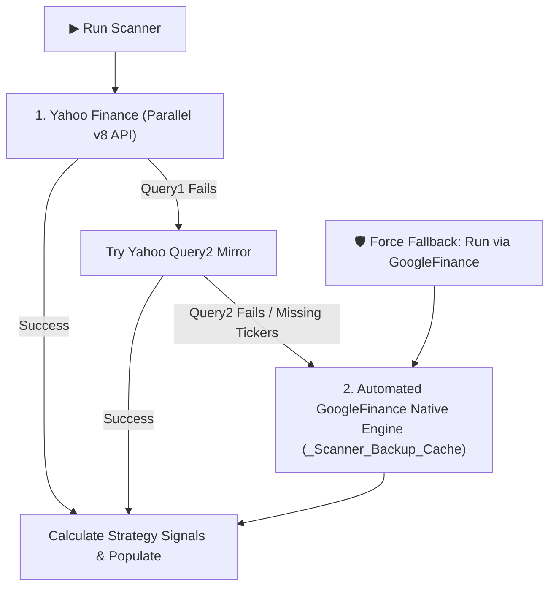

# Google Sheets Scanner Setup & Operational Guide
### *Darvas Bearish + Bullish Combo Systematic Strategy Scanner*

---

## 1. Overview of the Scanner Layout

The script is built specifically for the tab named **`Scanner`** based on your exact layout:

| Column | Header (Row 5) | Description & Population Method |
| :---: | :--- | :--- |
| **A** | `50 NSE Codes` | **Input Column (Row 7 downwards):** User enters stock tickers in `NSE:INFY`, `NSE:YESBANK`, `NSE:BHARTIARTL` format. |
| **B - D** | `Custom 1 - 3` | **User Custom Columns:** Untouched by the script; can be used for custom notes or user tags. |
| **E** | `Last Buy Price of Already Bought Stock` | **Dynamic Formula in E6:** `=IFERROR(ARRAYFORMULA(XLOOKUP(G6:G,'Current Holdings'!B:B,'Current Holdings'!C:C,,,-1)))` |
| **F** | `Distance between CMP and Last Buy Price` | **Dynamic Formula in F6:** `=IFERROR(ARRAYFORMULA(IF(E6:E="",,N6:N/E6:E-1)))` |
| **G** | `NSE Code` | **Output Column (Row 7 downwards):** Tickers sorted strictly in the 4-tier strategy order. |
| **H** | `Status` | **Sorted in this exact order:**<br>1. `Bullish Buy Triggered`<br>2. `Bearish Buy Triggered`<br>3. `Tracking for Bearish Buy Signal`<br>4. `Bullish Buy Running`<br>5. `Neutral / Inside 20W Range` |
| **I** | `Previous Week High` | **High of Last to Last Week ($W_{t-1}$)** |
| **J** | `Last Week's Close` | **Close of Last Completed Week ($W_t$)** |
| **K** | `Buy Signal` | `Bullish Buy Triggered`, `Bearish Buy Triggered`, or Blank. |
| **L** | `Breakout % (Rise)` | **Percentage rise:** `(Col J - Col I) / Col I` = `(Last Week Close - Last to Last Week High) / Last to Last Week High`. Formatted as `0.00%`. Sorted least risen first for triggered stocks. |
| **M** | `Buy Limit Ceiling (+0.5%)` | **Dynamic Formula in M6:** `=IFERROR(ARRAYFORMULA(IF(K6:K="",,CEILING(J6:J*1.005,0.05))))` *(Calculated from Col J Close)* |
| **N** | `CMP` | **Dynamic Formula in N6:** `=IFERROR(MAP(G6:G,LAMBDA(ticker, IF(ticker="",, GOOGLEFINANCE(ticker,"price")))))` |
| **O** | `20W Low Breakdown` | Displays `'20W Low Breakdown'` if 20-week low was touched in recently completed week, else Blank. |
| **P & Q** | *(Deleted)* | **Deleted by user** — script does not populate anything in Columns P or Q. |

---

### Executive Summary KPI Cards (Rows 1–2, Columns G through O)

The top rows **Rows 1–2 from Column G onwards** are dynamically formatted into three modern KPI summary cards (Row 3 is kept completely clear as a clean visual spacer):

```
┌───────────────────────────────────────┬───────────────────────────────────────┬───────────────────────────────────────┐
│        Columns G : I (Card 1)         │        Columns J : L (Card 2)         │        Columns M : O (Card 3)         │
├───────────────────────────────────────┼───────────────────────────────────────┼───────────────────────────────────────┤
│         Bullish Buy Triggered         │         Bearish Buy Triggered         │           Last Scan ran on            │
│                  2                    │                  1                    │           17-Oct-2026 20:20           │
└───────────────────────────────────────┴───────────────────────────────────────┴───────────────────────────────────────┘
```

1. **Card 1: Bullish Buy Triggered (Columns G to I, Rows 1–2)**
   - **Row 1:** Header title `"Bullish Buy Triggered"` (Soft Emerald background `#D1FAE5`, dark green text `#065F46`, bold 11pt).
   - **Row 2:** Metric count of triggered bullish stocks (Large bold 20pt font `#047857`, soft background `#ECFDF5`).
   - **Border:** Soft emerald medium border `#A7F3D0` around `G1:I2`.

2. **Card 2: Bearish Buy Triggered (Columns J to L, Rows 1–2)**
   - **Row 1:** Header title `"Bearish Buy Triggered"` (Soft Blue background `#DBEAFE`, dark blue text `#1E40AF`, bold 11pt).
   - **Row 2:** Metric count of triggered bearish dip-harvester stocks (Large bold 20pt font `#1D4ED8`, soft background `#EFF6FF`).
   - **Border:** Soft blue medium border `#BFDBFE` around `J1:L2`.

3. **Card 3: Last Scan ran on (Columns M to O, Rows 1–2)**
   - **Row 1:** Header title `"Last Scan ran on"` (Soft Slate background `#E2E8F0`, dark slate text `#1E293B`, bold 11pt).
   - **Row 2:** Execution timestamp strictly formatted in **`dd-mmm-yyyy HH:MM`** (e.g. `17-Oct-2026 20:20`, bold 13pt font `#0F172A`, light slate `#F8FAFC`).
   - **Border:** Soft slate medium border `#CBD5E1` around `M1:O2`.

---

## 2. Core Execution Mechanics: How Signals are Tracked

```
┌───────────────────────────────────────┬───────────────────────────────────────┐
│     Column I (High of Last to Last)   │        Column J (Close of Last Week)  │
│               1,854.70                │                   1,905.00            │
└───────────────────────────────────────┴───────────────────────────────────────┘
                                       ▲
   Trigger Check: Is Close of Last Week (Col J) > High of Last to Last Week (Col I) ?
   1,905.00 > 1,854.70  ==>  YES (Breakout Triggered!)
   Col L (Breakout % Rise): (1,905.00 - 1,854.70) / 1,854.70 = +2.71%
   Col M (Buy Limit Ceiling): CEILING(1,905.00 * 1.005, 0.05) = 1,914.55
```

### 1. Robust Indian Standard Time (IST) & Exchange Holiday Week Detection:
* The script uses a dynamic calendar week resolver with explicit **NSE Exchange Holiday awareness**:
  - **Holiday-Shortened Weeks (e.g. Week Ending Thursday 1 Oct 2026 before Gandhi Jayanti):**
    - Both Yahoo Finance and GoogleFinance automatically package shortened weeks into a single weekly bar with the **Thursday close**.
    - If executed on **Thursday after 3:30 PM IST** before a Friday holiday, or **anytime on the Friday holiday**, the script automatically recognizes that the exchange closed on Thursday and treats that Thursday as the completed weekly close!
  - **Normal Weeks:**
    - If executed on **Friday after 3:30 PM IST**, or on **Saturday / Sunday**:
      - **Last Week ($W_t$):** The week that just completed (Close goes to **Col J**).
      - **Last to Last Week ($W_{t-1}$):** The prior completed week (High goes to **Col I**).
  - **Mid-Week Safeguard (Monday to Friday before 3:30 PM IST):**
    - The ongoing, incomplete week is automatically ignored to protect against executing on partial fluctuating bars.
    - Evaluates the previously finalized completed week.

### 2. Bearish Tracking Trigger: 20-Week Low Touched
* Tracking starts as soon as the **Weekly Low touches or breaches the rolling 20-Week Low** (`Weekly Low <= 20W Low`).
* **Bharti Airtel Case Study:**
  - **Week ending 1 Oct 2026:** Bharti Airtel touched its 20-week low $\rightarrow$ `isTracking20w` turned **ON** (`Tracking for Bearish Buy Signal`).
  - **Week ending 9 Oct 2026:**
    - High of Last to Last Week (Col I) = `1,854.70`
    - Close of Last Week (Col J) = `1,905.00`
    - Since `1,905.00 > 1,854.70`, **`Bearish Buy Triggered`** fired cleanly!

### 3. Strict Priority Sorting in Column H:
The stocks in Columns G through O are sorted strictly in your exact specified priority:
1. **`Bullish Buy Triggered`:** Fresh 20-week high breakouts this week, sorted by Column L `Breakout % (Rise)` ascending (least risen first at the top for best risk/reward entry).
2. **`Bearish Buy Triggered`:** 20W floor touched & weekly swing breakout this week (`Close > Prev Week High`), sorted by Column L `Breakout % (Rise)` ascending.
3. **`Tracking for Bearish Buy Signal`:** Stocks that touched their 20W floor and are awaiting a weekly swing breakout (e.g. `NSE:YESBANK`).
4. **`Bullish Buy Running`:** Stocks previously bought on a Bullish signal that have **not touched the 20-week low yet** (e.g. `NSE:ABCAPITAL`). These are active compounders riding the bull run above the 20W floor.
5. **`Neutral / Inside 20W Range`:** Stocks fluctuating inside range without touching 20W low or high breakout.

*(Note: If a previously running bullish stock touches its 20-week low, it immediately ceases to be 'Bullish Buy Running' and transitions into 'Tracking for Bearish Buy Signal'. If that breakdown happened during the completed week, Col O flags '20W Low Breakdown'.)*

---

## 3. Step-by-Step Installation in Google Sheets

### Step 1: Open Apps Script
1. Open your Google Sheet containing the **`Scanner`** tab.
2. In the top menu, click **Extensions** $\rightarrow$ **Apps Script**.

### Step 2: Paste the Updated Script
1. Select all and replace the contents of `Code.gs` with the updated code from [google_apps_script_scanner.js](file:///c:/Users/krish/API/Anti%20Gravity/Strategies/Darvas%20Bearish%20+%20Bullish%20combo/google_apps_script_scanner.js).
2. Click the **💾 Save** icon (or press `Ctrl + S`).

### Step 3: Run the Scanner
1. Return to your Google Sheet and refresh the page (`F5`).
2. Click **`⚡ Darvas Scanner`** in the top menu $\rightarrow$ **`▶ Run Scanner Now`**.
3. The scanner will fetch data in parallel from Yahoo Finance, calculate all signals, populate rows, and apply conditional colors automatically.

---

## 4. Dual-Engine Resilience & High Availability

To ensure the scanner never fails even if Yahoo Finance experiences downtime or network throttling, the system includes a **two-tier automatic failover architecture**:



### 1. Automatic Failover:
* **Primary (Yahoo Finance):** Fetches all 50+ tickers in parallel via `UrlFetchApp.fetchAll` in ~1.5 seconds.
* **Secondary Mirror (`query2`):** If `query1` encounters an error, the script immediately retries via `query2.finance.yahoo.com`.
* **Tertiary Native Fallback (`GOOGLEFINANCE`):** If Yahoo Finance is completely down or returns missing data for specific tickers, the script automatically activates a hidden cache tab (`_Scanner_Backup_Cache`), calculates weekly historical candles via Google Sheets native `GOOGLEFINANCE()` function, and populates the scanner seamlessly.

### 2. Manual Emergency Override:
You can also force the scanner to run 100% via Google's internal engine at any time:
* Click **`⚡ Darvas Scanner`** $\rightarrow$ **`🛡 Force Fallback: Run via GoogleFinance`**.
