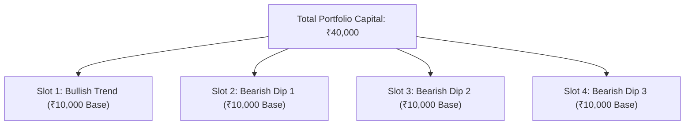
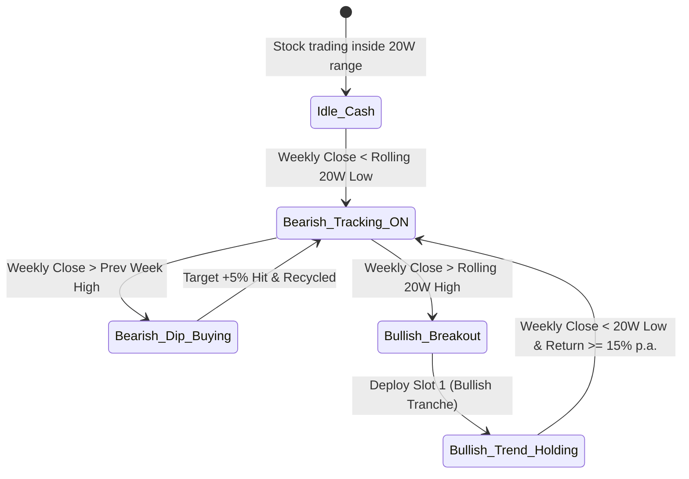

# Operational Rulebook: Darvas Bearish + Bullish Combo Strategy
### *A Complete Guide to What Happens Behind the Scenes in Our Systematic Backtesting Engine*

---

## Executive Summary: The Core Philosophy

Most equity investors struggle because stock markets spend **70% of the time in messy corrections, choppy channels, or pullbacks**, and only **30% of the time in clean bull runs**. 

* If you **buy and hold**, your capital gets trapped during painful multi-month drawdowns.
* If you **chase momentum**, you often buy at the peak and panic-sell at the bottom.

Our **Darvas Bearish + Bullish Combo Systematic Engine** eliminates emotions entirely by combining two complementary engines into a single automated system:

1. **Engine 1 (Bearish Dip-Harvester):** When the stock enters a correction, our radar activates. It buys weekly swing bounces and exits quickly at a strict **+5.0% profit target**, turning frustrating dips into high-velocity cash generators.
2. **Engine 2 (Bullish Macro Trend-Rider):** When the stock breaks out to a fresh 20-week high, the system commits 1 dedicated tranche to ride the macro bull trend. It is **never capped at 5%**; it holds patiently until the multi-year uptrend ends.

---

## 1. Capital Architecture & The 4-Tranche Framework

The strategy divides total portfolio capital into 4 discrete, isolated buckets called **Tranches** (or Slots).

### Capital Allocation Rules:
- **Total Capital:** `40,000` (₹40,000 per stock).
- **Number of Slots:** `4` equal parts.
- **Base Tranche Size:** `10,000` per slot.
- **Maximum Concurrent Exposure:** Never more than `4` active positions at any time.
- **Share Sizing Formula:**  
  $$\text{Shares} = \left\lfloor \frac{\text{Tranche Capital}}{\text{Buy Price}} \right\rfloor$$
  *(Any leftover cash remains 100% safe in bank reserves earning idle interest).*
- **Dynamic Compounding:** As realized profits and dividends roll in, total capital grows. Each future tranche automatically sizes up:
  $$\text{Dynamic Tranche Capital} = \frac{\text{Initial Capital} + \text{Realized Profits} + \text{Dividends}}{4}$$

---

## 2. Phase 1: When Does Tracking Start? (The 20-Week Radar)

The engine monitors a rolling **20-week lookback window** (approximately 5 months of trading data, representing a complete institutional cycle).

### The Three State Rules:
1. **The Normal / Idle State (😴):**
   - The stock is fluctuating quietly in the middle of its 20-week channel. The engine takes zero action; capital sits 100% safe in cash.
2. **Bearish Tracking Activation (🚨):**
   - **Trigger:** On Friday at 3:30 PM, the **Weekly Close drops below the Rolling 20-Week Low** (`Close < 20W Low`).
   - **What happens behind the scenes:** The engine flags that the stock has entered a major corrective phase. The **Bearish Radar turns ON**.
3. **Radar Deactivation & Bullish Shift (🚀):**
   - **Trigger:** A Friday Weekly Close breaks above the **Rolling 20-Week High** (`Close > 20W High`).
   - **What happens behind the scenes:** The Bearish Radar turns OFF. The downtrend is officially over, and the Bullish Momentum Engine engages!

---

## 3. Phase 2: When is Buying Done & How Tranches are Deployed?

Order execution is split into a **2-step mechanical process** to prevent emotional impulse buying:

### Step A: Weekly Signal Generation (Friday Close)
- At the close of Friday (Week $W_t$), the engine checks:
  $$\text{Weekly Close}_{W_t} > \text{Weekly High}_{W_{t-1}}$$
- If TRUE, the stock has staged a swing breakout from the pullback.
- The engine calculates the **Entry Price Ceiling**:
  $$\text{Entry Ceiling} = \text{Friday Close} \times 1.005 \quad (+0.5\% \text{ buffer})$$
- A **Pending Buy Setup** is queued for the upcoming week ($W_{t+1}$).

### Step B: Daily Execution (Monday to Friday)
- During the next trading week, the engine checks each daily bar:
  $$\text{Is Daily Low} \le \text{Entry Ceiling?}$$
- If YES and an open slot exists:
  - **Buy Order Fills:** $\text{Buy Price} = \min(\text{Daily Open}, \text{Entry Ceiling})$.
  - **Target Price Set:** $\text{Buy Price} \times 1.05$ (+5.0% profit).
  - Slot is marked **ACTIVE**.
- If the week ends without the price touching the ceiling (e.g., massive runaway gap up), the order expires with zero penalty. Cycle repeats next week.

### Four Critical Guardrails:
1. **1️⃣ Max 1 Tranche Per Week:** Even during violent rallies, the engine never deploys more than 1 tranche in a single calendar week.
2. **2️⃣ Strict 4-Slot Cap:** Once all 4 slots are full, all subsequent buy signals are strictly blocked.
3. **3️⃣ Discrete Share Sizing:** Never borrows money, never trades fractional shares.
4. **4️⃣ Anti-Clustering:** Prevents buying two tranches at identical price levels.

---

## 4. Phase 3: When Are Tranches Sold? (The Dual Exit Paths)

The engine enforces two completely different exit philosophies depending on whether the tranche is **Bearish** or **Bullish**:

### Route A: Bearish Dip Tranches (Slots 2 to 4) — Fast Turnover 🎯
* **The Rule:** The instant `Daily High >= Buy Price * 1.05`, the tranche sells at the exact +5% target.
* **Average Duration:** Typically 20 to 45 calendar days (often as fast as 5 to 10 days!).
* **Immediate Recycling 🔄:** The invested capital + profit returns to available cash, and the slot is **immediately freed up** to catch the next signal.
* **No Stop Loss:** Blue-chip Indian large-cap pullbacks are temporary. The system does not panic-sell; it patiently holds each tranche until the +5% bounce occurs.

### Route B: Bullish Momentum Tranche (Slot 1) — Long-Term Compounder 🚀
* **The Rule:** Never capped at 5%! Designed to ride multi-year macro bull runs.
* **Exit Trigger:** Evaluated on Friday close and sold ONLY when **BOTH** conditions are met:
  1. **Condition 1:** Weekly Close drops below the Rolling 20-Week Low (`Close < 20W Low`).
  2. **Condition 2:** The simple annualized return achieved is $\ge$ **15% per annum** for the time held:
     $$\text{Hurdle Return } \% = 15\% \times \left(\frac{\text{Calendar Days Held}}{365.25}\right)$$
* In **INFY**, Slot 1 entered in July 2020 at ₹903.15 and was held through April 2022 to exit at ₹1,585.45, capturing a **+75.55% gain (+₹8,187.60 cash profit)** in 644 days!

---

## 5. Live Case Study: INFY (Infosys Ltd) Performance (2020–2026)

We ran the strategy backtesting engine on **Infosys (INFY.NS)** from **01-Jan-2020 to 2026** with a starting capital of **₹40,000**.

### The Performance Scorecard

| Performance Metric | Strategy Result | Real-World Meaning |
| :--- | :---: | :--- |
| **Starting Capital** | `₹40,000` | Initial capital allocated. |
| **Total Realized Profit** | `₹40,723.97` | **+101.8% cash profit** booked into bank! Capital doubled! |
| **Total Trades Taken** | `35 Trades` | 1 Bullish Master Tranche + 34 Bearish Dip Tranches. |
| **Completed Trades** | `33 Trades` | All 33 completed trades hit profit targets. |
| **Win Rate** | **100.0%** | **Zero losing trades** were realized across 6 years. |
| **Active Open Positions** | `2 Trades` | Currently open and compounding. |
| **Max Drawdown** | **-20.6%** | Calmly weathered COVID-19 crash and the 2022 tech pullback. |
| **Deployed Capital XIRR** | **24.7% p.a.** | Annualized rate of return on invested capital! |
| **Total Portfolio Return** | **92.3%** | Net return across the entire account. |
| **Max Active Slots Used** | **4 / 4 Slots** | Full utilization reached only during major market dips. |

---

### Key Executions from the INFY Trade Journal

Here is a sample of actual trades executed by the system on Infosys:

| Trade # | Slot | Type | Buy Date | Buy Price (₹) | Shares | Sell Date | Sell Price (₹) | Realized Profit (₹) | Days Held | Status |
| :---: | :---: | :---: | :---: | :---: | :---: | :---: | :---: | :---: | :---: | :---: |
| **1** | Slot 1 | Bearish | 03-Jan-2020 | 746.00 | 13 | 23-Jan-2020 | 783.30 | **+484.90** | 20 | **CLOSED (+5%)** |
| **2** | Slot 2 | Bearish | 17-Jan-2020 | 767.85 | 13 | 24-Feb-2020 | 806.24 | **+499.07** | 38 | **CLOSED (+5%)** |
| **4** | Slot 2 | Bearish | 27-Mar-2020 | 652.70 | 15 | 30-Apr-2020 | 685.34 | **+489.60** | 34 | **CLOSED (+5%)** |
| **5** | Slot 3 | Bearish | 24-Apr-2020 | 658.00 | 15 | 30-Apr-2020 | 690.90 | **+493.50** | 6 | **CLOSED (+5%)** |
| **9** | Slot 2 | Bearish | 10-Jul-2020 | 781.85 | 13 | 15-Jul-2020 | 820.94 | **+508.17** | 5 | **CLOSED (+5%)** |
| **10** | Slot 1 | **Bullish** | 17-Jul-2020 | 903.15 | 12 | 22-Apr-2022 | 1,585.45 | **+8,187.60** | 644 | **CLOSED (+75.5%)** |
| **12** | Slot 2 | Bearish | 01-Jul-2022 | 1,479.40 | 9 | 29-Jul-2022 | 1,553.37 | **+665.73** | 28 | **CLOSED (+5%)** |
| **18** | Slot 3 | Bearish | 28-Oct-2022 | 1,513.25 | 9 | 14-Nov-2022 | 1,588.91 | **+680.94** | 17 | **CLOSED (+5%)** |
| **25** | Slot 4 | Bearish | 28-Jun-2024 | 1,566.75 | 9 | 04-Jul-2024 | 1,645.09 | **+705.06** | 6 | **CLOSED (+5%)** |
| **32** | Slot 1 | Bearish | 02-Apr-2026 | 1,300.80 | 13 | 08-Apr-2026 | 1,365.84 | **+845.52** | 6 | **CLOSED (+5%)** |
| **34** | Slot 1 | Bearish | 31-Jul-2026 | 1,130.10 | 16 | 10-Aug-2026 | 1,186.61 | **+904.16** | 10 | **CLOSED (+5%)** |

---

### Three Crucial Insights from the Live Data:

1. **🚀 The Macro Bullish Trend-Rider:**
   - Notice Trade #10: While retail investors exit at small gains, the strategy let the Bullish Tranche ride all the way from **₹903.15 to ₹1,585.45**, locking in **+₹8,187.60 (+75.5%)**!
2. **⚡ High-Velocity Cash Recycling:**
   - Look at the holding periods: Trade #5 took **6 days**, Trade #9 took **5 days**, Trade #25 took **6 days**, Trade #32 took **6 days**!
   - Capital is never trapped in endless waiting; it rotates continuously.
3. **📈 Compounding Dynamic Sizing:**
   - In 2020, Trade #1 made **₹484.90** on ₹9,698 invested.
   - In 2026, Trade #34 made **₹904.16** on ₹18,081 invested (**+86% larger profit**!).
   - Why? Because dynamic compounding scaled each tranche size from ₹10,000 to over ₹18,000 automatically!

---

## 6. Generated Files & Deliverables

* **PowerPoint Presentation (Updated with charts & emojis):**  
  👉 [Darvas_Strategy_Rulebook_Deck_v2.pptx](file:///c:/Users/krish/API/Anti%20Gravity/Strategies/Darvas%20Bearish%20+%20Bullish%20combo/Darvas_Strategy_Rulebook_Deck_v2.pptx)
* **Backtest Excel Workbook for INFY:**  
  👉 [Weekly_Breakout_Combo_INFY.xlsx](file:///c:/Users/krish/API/Anti%20Gravity/Strategies/Darvas%20Bearish%20+%20Bullish%20combo/output/Bearish%20+%20Bullish%20Combo/Weekly_Breakout_Combo_INFY.xlsx)
* **High-Res Charts & Infographics:**  
  - [Price Chart with Bands](file:///c:/Users/krish/API/Anti%20Gravity/Strategies/Darvas%20Bearish%20+%20Bullish%20combo/graphics/infy_price_chart.png)
  - [Compounding Curve](file:///c:/Users/krish/API/Anti%20Gravity/Strategies/Darvas%20Bearish%20+%20Bullish%20combo/graphics/infy_equity_curve.png)
  - [4-Tranche Architecture](file:///c:/Users/krish/API/Anti%20Gravity/Strategies/Darvas%20Bearish%20+%20Bullish%20combo/graphics/tranche_architecture.png)
  - [Radar State Workflow](file:///c:/Users/krish/API/Anti%20Gravity/Strategies/Darvas%20Bearish%20+%20Bullish%20combo/graphics/radar_workflow.png)
